<div align="center">

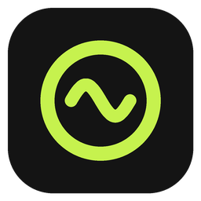

# NabyTune

### YouTube Music, your way, on Windows.

A native music player built in Rust: synced lyrics that sing along word by word, a full-screen
stage that takes its colours from every cover, lyrics floating on your desktop, and a Wrapped
of your own whenever you want it.


[**Download**](../../releases/latest) · [Features](#what-it-does) · [Screenshots](#a-closer-look) · [Support](#-support-nabytune)

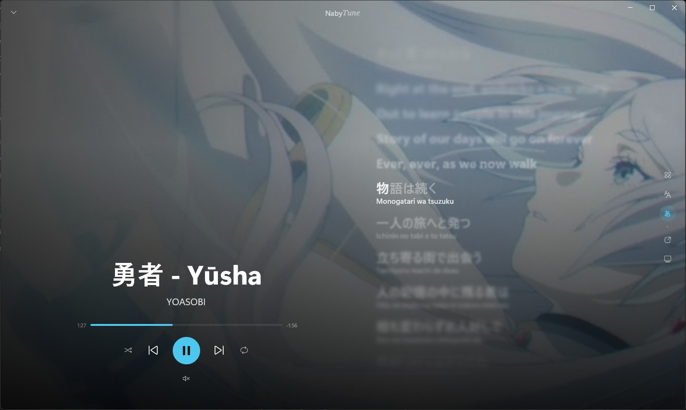

</div>

> [!TIP]
> **NabyTune is free, with no ads and no analytics, made by one developer.** If it becomes part of your day,
> a coffee keeps it going: **[Saweria](https://saweria.co/billynabil)** · **[Ko-fi](https://ko-fi.com/billynabil)** 💛

---

## Why NabyTune

- **It's a real app, not a web page in a window.** NabyTune draws every frame itself on the GPU,
  plays audio through its own engine, and uses about **150 MB of memory**.
- **Lyrics are the main event.** Lines are synced to the music and light up word by word. Japanese,
  Chinese, Korean, Russian, Greek, Hindi, Thai and Arabic can show in Latin letters below or in place of the original.
- **Every song gets its own look.** The accent colour, the glow behind the app and the full-screen
  background all come from the cover that's playing.
- **Your listening, kept on your PC.** Stats and ten Wrapped card designs work from your own
  listening history. You can hide what you'd rather not see, or clear it all.

## What it does

| | |
|---|---|
| 🎤 **Synced lyrics** | Word-by-word karaoke, six lyric looks, blur-to-focus, a click on a line jumps to it, and `[` / `]` move the timing when a source is off. Lyrics come from lrc.red, BiniLyrics, BetterLyrics, LyricsPlus, Unison, KuGou, LRCLIB and YouTube Music, asked all at once with word-timed sources first, and you can switch between them. |
| 🔤 **Lyrics in Latin letters** | Choose Latin only or Original + Latin for Japanese, Korean, Chinese, Cyrillic, Greek, Devanagari, Thai, Arabic and more. Readings are generated offline. |
| 🖥️ **Full-screen stage** | Five layouts (*Side by side*, *Center*, *Full cover*, *Lyrics only*, *Card*), five backgrounds, and visuals that move with the beat. |
| 🪟 **Lyrics on the desktop** | The sung line floats over games, browsers and anything else. Lock it and clicks pass straight through. Pick Custom, Cinema, Neon, or Editorial in Settings or from the overlay. Each preset remembers its backdrop and border. |
| 📻 **Mini player** | A small window that stays on top. Pick Classic, Vinyl, Cassette, or Spotlight in Settings or click the preset name in the player. Lyrics can show Latin letters or an English translation when available. |
| 📊 **Stats and Wrapped** | Minutes, top songs and artists, when you listen, and new discoveries. Ten Wrapped card designs, each saved as a picture in one click. |
| ♾️ **Endless radio** | Start a radio from any song or artist and steer it toward *Popular*, *Discover*, *Deep cuts* and more. |
| 🎧 **Listen along** | Host a session and share its code: friends hear the same song at the same moment, each on their own PC, and can send songs to your queue. |
| 🫶 **Blend** | Mix your taste with a friend's into one playlist (songs you both love first, then turns from each of you) and see how alike you are. |
| ❤️ **Likes, both ways** | A heart in NabyTune is a like on YouTube Music, and the other way round. Likes made while offline go once you're back. |
| 🔗 **Share a song** | Copy any song's YouTube Music link from its menu or the dock; paste a link into search to open it. |
| 💿 **Your own files too** | Add music folders (MP3, FLAC, M4A, OGG, WAV) and they play beside YouTube Music, in search as well. |
| 🎚️ **Sound** | Five-band equalizer with presets, volume normalisation, crossfade, and lossless audio from addons. |
| 🎨 **Make it yours** | Accent colour from the album cover (or any colour you like), Mica, Mica Alt, Acrylic or Solid, and the whole app in English or Bahasa Indonesia. |
| 🧩 **Fits into Windows** | Media keys and the Windows media flyout, a tray icon, Discord "Listening to", a sleep timer, and keyboard shortcuts for everything. |

## A closer look

### The full-screen stage

Five layouts, with lyrics that glide and come into focus line by line.

| Side by side | Lyrics only |
|---|---|
| 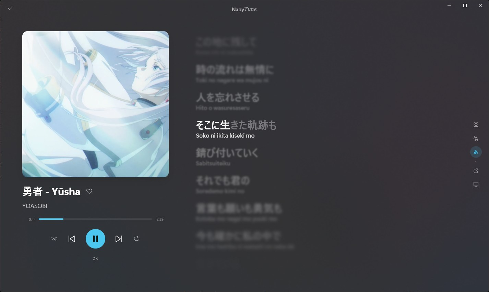 | 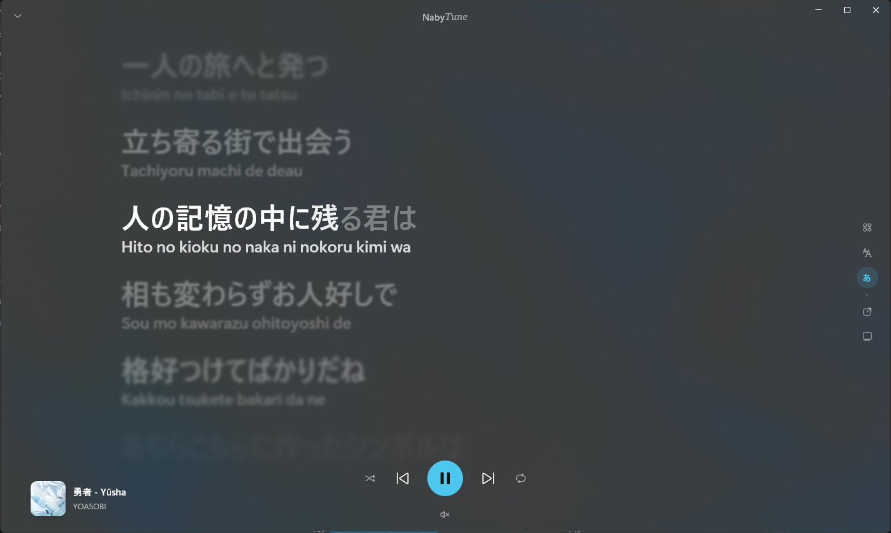 |
| **Card** | **Center** |
| 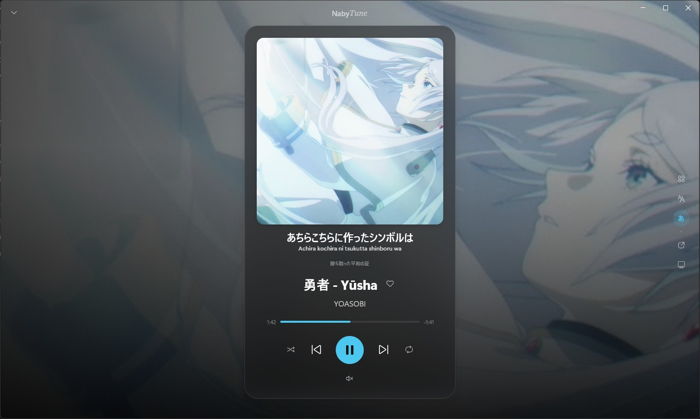 | 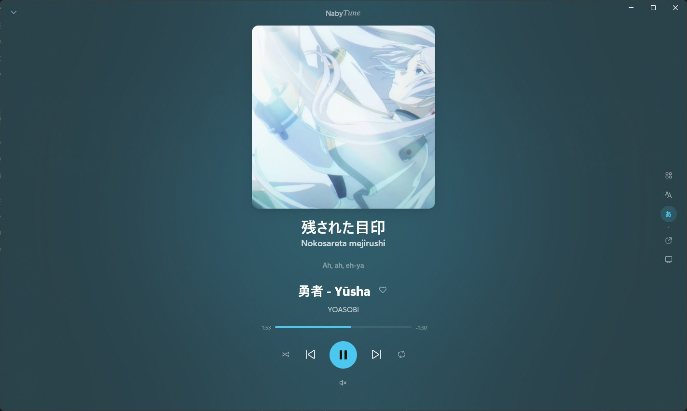 |

<details>
<summary><b>Layouts, backgrounds and visuals, one menu away</b></summary>
<br>
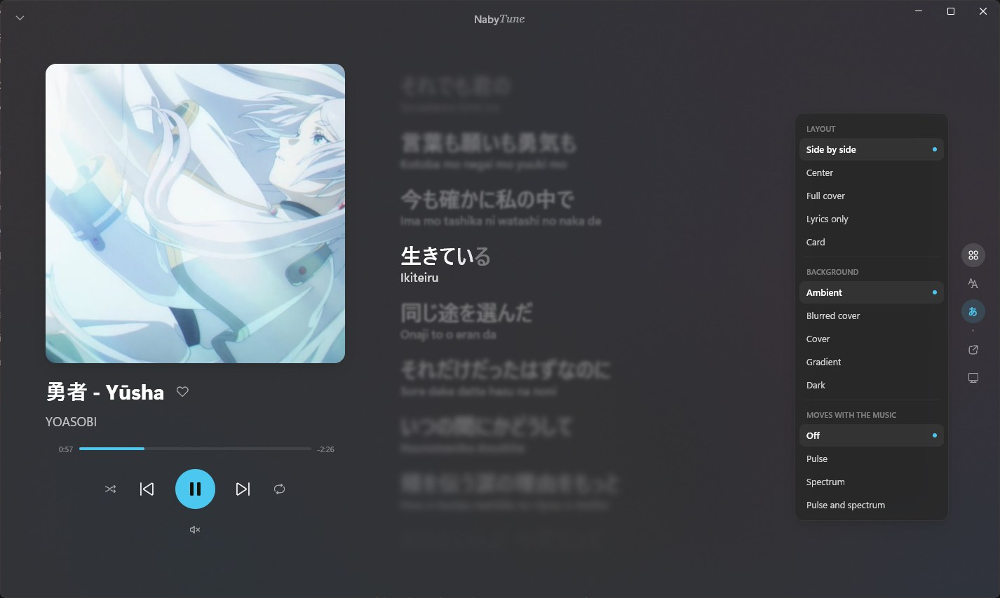
</details>

### Home, coloured by what's playing

YouTube Music's own shelves (*Quick picks*, *Mixed for you*, your playlists and new releases), plus
what you played lately and songs like it.

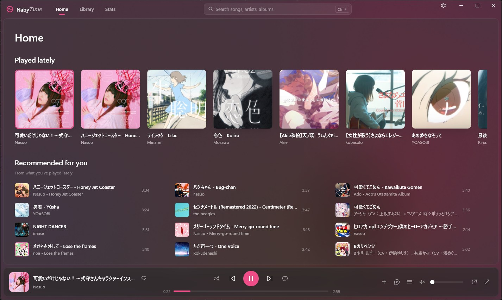

### Lyrics on your desktop, and a mini player

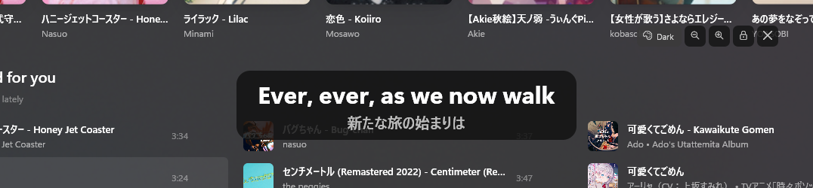

<p align="center">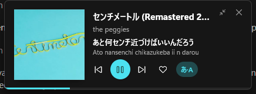</p>

### Stats that read like a story

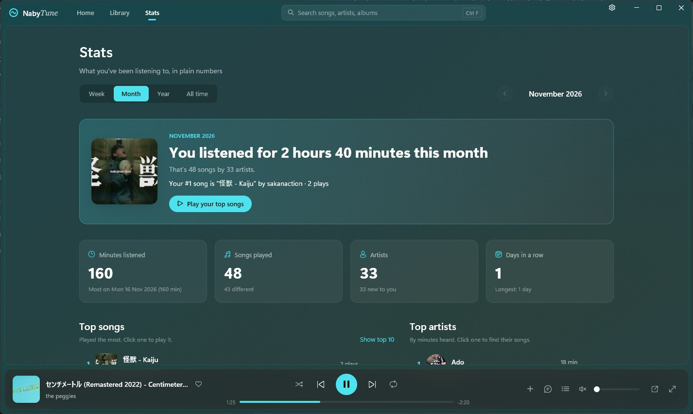

<details>
<summary><b>Top songs, top artists and when you listen</b></summary>
<br>
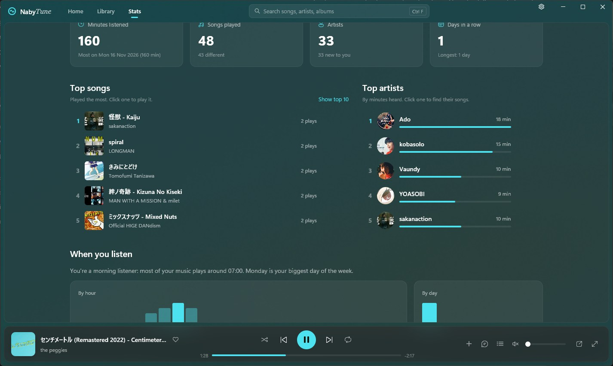
</details>

### Wrapped, ten ways

Your stretch of listening on one card, in ten designs: **Signature**, **Poster**, **Minimal**,
**Receipt**, **Neon**, **Aurora**, **Cassette**, **Polaroid**, **Big numbers** and **Magazine**.
Pick one and save it as a picture to share.

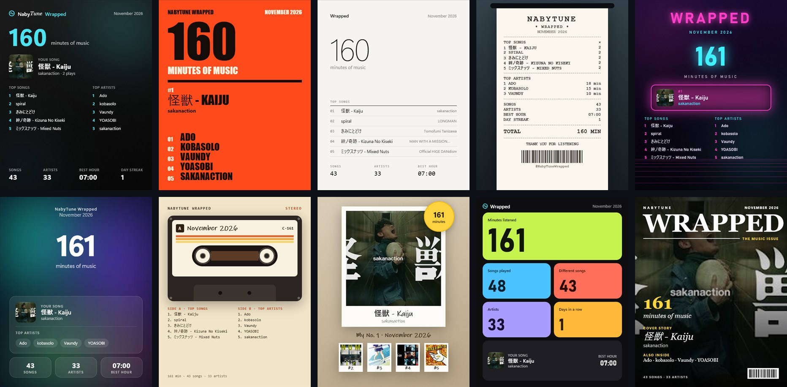

<details>
<summary><b>See each card full size</b></summary>
<br>

| | | |
|---|---|---|
| 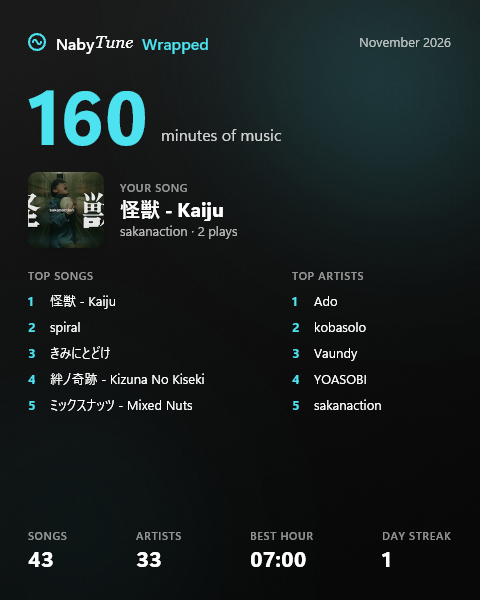 | 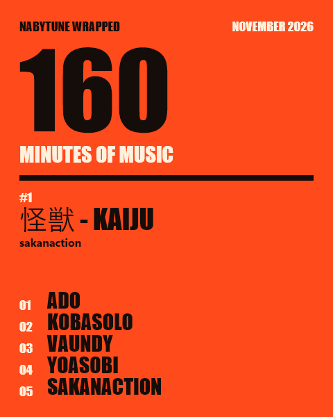 | 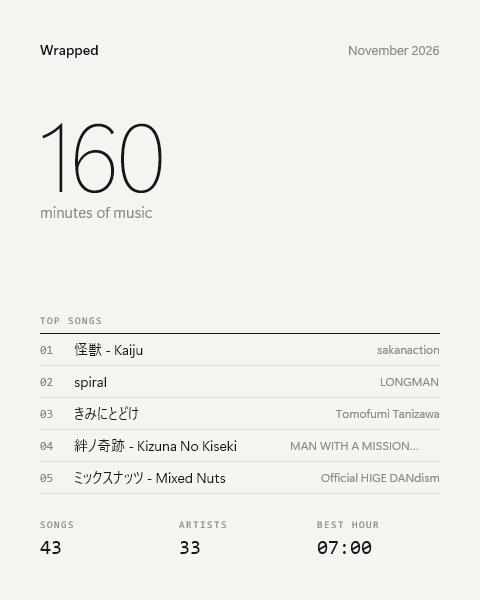 |
| 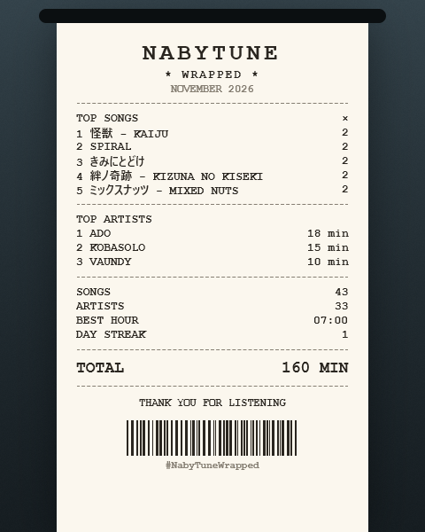 | 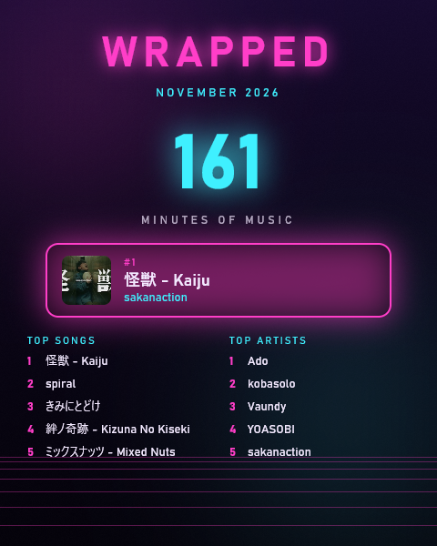 | 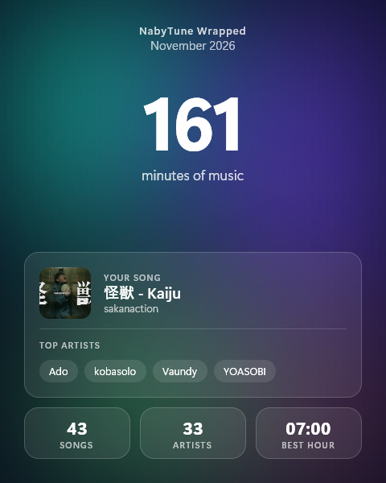 |
| 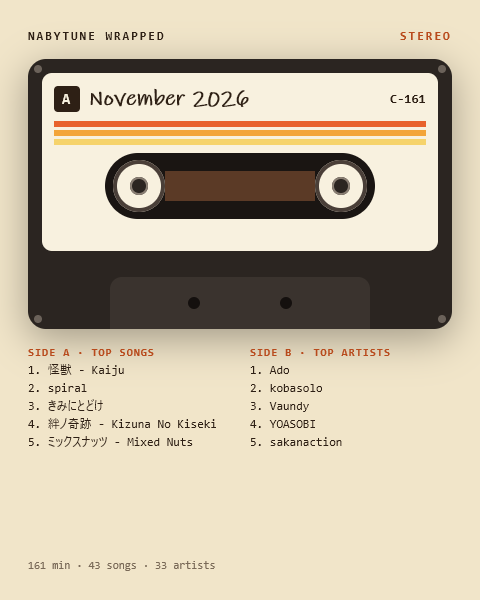 | 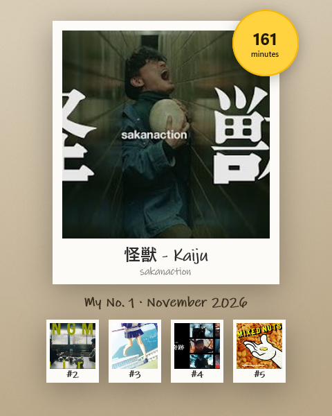 | 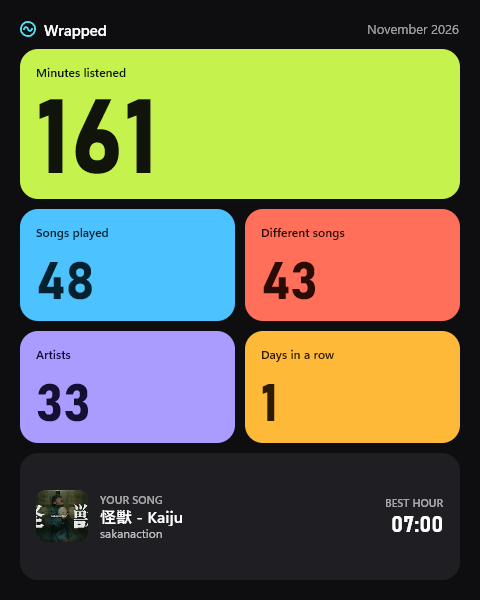 |
| 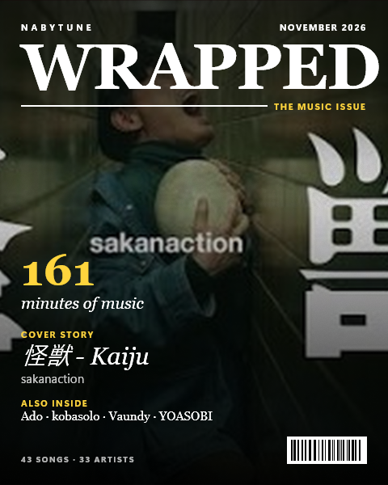 | | |

</details>

### Settings that stay simple

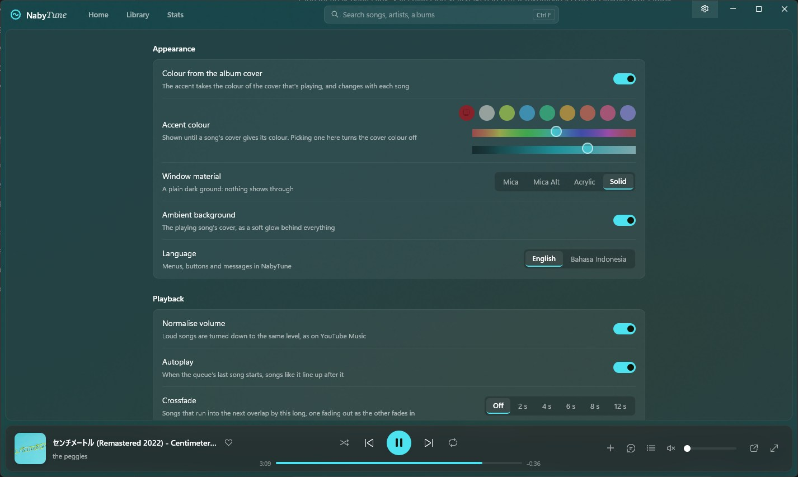

## Get started

1. Download **`NabyTune-Setup.exe`** from the [latest release](../../releases/latest) and run it.
   It installs for your user only, no admin rights needed.
2. Open NabyTune and sign in to YouTube Music from **Settings › Account** to get your library,
   playlists and likes. You can also skip signing in and just search and play.
3. Press **F** for the full-screen stage, **Ctrl + D** for lyrics on the desktop, or **Ctrl + M** for the mini player.

**No installer?** Download **`NabyTune-portable.zip`** from the same release instead, extract it
anywhere (keep the files together), and open `NabyTune.exe`.

> [!NOTE]
> NabyTune isn't code-signed yet, so Windows and your browser don't recognise it at first and may hold it back:
>
> - **Edge**: the download shows as blocked. Click **…** next to it, then **Keep**, then **Show more › Keep anyway**.
> - **Chrome**: open the downloads list (**Ctrl + J**) and choose **Keep** (or **Download suspicious file**).
> - **Windows SmartScreen** ("Windows protected your PC"): choose **More info › Run anyway**.
> - **Microsoft Defender** removing the file: that's a false alarm on a new, unsigned app. Restore it from
>   **Windows Security › Virus & threat protection › Protection history**, or use the portable zip.
>
> You can check the download is the real one: its SHA-256 is listed on the release page (`NabyTune-Setup.exe.sha256`).

### Keyboard shortcuts

| Keys | Does | Keys | Does |
|---|---|---|---|
| `Space` | Play or pause | `← / →` | Back or ahead 5 seconds |
| `↑ / ↓` | Volume up or down | `Ctrl + → / ←` | Next or previous song |
| `M` | Mute | `L` | Like the song |
| `S` | Shuffle | `R` | Repeat |
| `F` | Full screen | `Esc` | Leave full screen |
| `[ / ]` | Lyrics earlier or later | `Ctrl + M` | Mini player |
| `Ctrl + D` | Lyrics on the desktop | `Ctrl + F` | Search |
| `Ctrl + ,` | Settings | `Alt + ←` / mouse back | Back |

## Under the hood

- **Rust**, with **[GPUI](https://github.com/zed-industries/zed/tree/main/crates/gpui)** for the
  interface (DirectX 11 and DirectWrite), so animations run on the GPU and the window stays light.
- **Its own audio engine**: decoding with [symphonia](https://github.com/pdeljanov/Symphonia)
  (AAC, FLAC, ALAC, MP3, Vorbis, WAV), output through WASAPI, with the equalizer, crossfade and
  spectrum analysis written for NabyTune.
- **Romaji worked out on your PC**: Japanese readings from a built-in dictionary
  ([lindera](https://github.com/lindera/lindera) with IPADIC), the other scripts by rule. No lyrics
  are sent anywhere to be romanised.
- **Sound that holds up on a busy PC**: songs are decoded seconds ahead on a thread of their own,
  the output runs at Windows' real-time audio priority (MMCSS), and NabyTune opts out of Windows'
  power throttling, so dragging the window or a heavy app on a laptop doesn't make it stutter.
- **Your data stays on your PC**: settings, library, listening history and stats live in
  `%APPDATA%\NabyTune`. Your YouTube Music sign-in is encrypted for your Windows user (DPAPI).
- **Listen along and Blend** go through a relay, [ntfy](https://ntfy.sh) (ntfy.sh unless you set
  your own server in *Settings › Windows and Discord*): only what plays, a first name and a taste
  of a few dozen songs, under a random code. Nothing is sent unless you start or join one. ntfy.sh
  takes about 250 messages a day per internet address; a self-hosted ntfy server has no such limit.

### Build it yourself

```powershell
# Rust (stable) on Windows; then, in this folder:
cargo build --release --bins                   # build the app and sign-in helper
cargo run --release --bin nabytune-gpui-proto  # run it
.\package.ps1                    # build target\package\NabyTune-Setup.exe
```

## 💛 Support NabyTune

NabyTune is free and always will be, with no ads, no paywalls and no analytics. It's built and kept up
by one developer, between everything else. If it plays in the background of your day, you can help
keep it going:

<p align="center">
  <a href="https://saweria.co/billynabil"></a>
  &nbsp;
  <a href="https://ko-fi.com/billynabil"></a>
</p>

- **Saweria** works best from Indonesia (QRIS, e-wallets, bank transfer).
- **Ko-fi** works from anywhere (card, PayPal).

Not in a position to donate? Starring the repo, sharing a screenshot of your Wrapped, or
reporting a bug helps just as much. Thank you! 🙏

<p align="center"><sub>The Support buttons are in the app too, at the top of <b>Settings</b>.</sub></p>

## Credits and license

NabyTune is inspired by and built on **[BitChord](https://github.com/kushagrasinghx/BitChord)**,
© Kushagra Singh and its contributors. It was turned into NabyTune by BillyNabil in 2026. See
[CREDITS.md](CREDITS.md).

NabyTune is free software under the **GNU General Public License v3** (see [LICENSE](LICENSE)).
It comes with no warranty of any kind.

<sub>NabyTune is an unofficial app and isn't affiliated with, endorsed by or connected to YouTube
or Google. YouTube Music is a trademark of Google LLC. Lyrics belong to their writers and are shown
from public lyrics sources.</sub>
